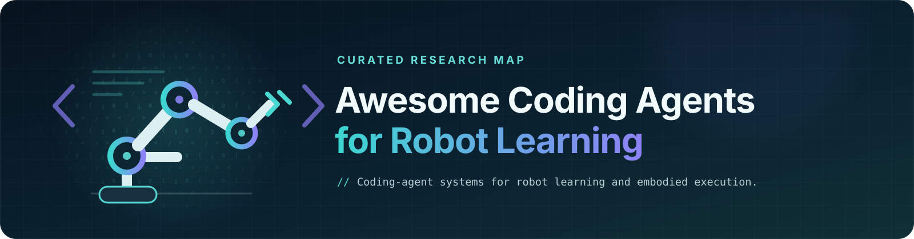

<div align="center">
  
</div>

<h1 align="center">Awesome Coding Agents for Robot Learning</h1>

<p align="center">
  <strong>Coding-agent systems for robot learning and embodied execution.</strong>
</p>

<p align="center">
  <a href="https://awesome.re"></a>
  
  
  
  <a href="LICENSE"></a>
  <a href="CONTRIBUTING.md"></a>
</p>

<p align="center">
  <a href="#-code-as-policy"><code>Code as Policy</code></a>&nbsp;
  <a href="#-robot-use-agents"><code>Robot-Use Agents</code></a>
  <br>
  <a href="#-environments-and-tasks"><code>Environments &amp; Tasks</code></a>&nbsp;
  <a href="#-reward-design"><code>Reward Design</code></a>&nbsp;
  <a href="#-policy-evaluation"><code>Policy Evaluation</code></a>&nbsp;
  <br>
  <a href="#-synthetic-data"><code>Synthetic Data</code></a>&nbsp;
  <a href="#-robot-autoresearch"><code>Robot Autoresearch</code></a>
</p>

Robot learning is becoming **agent-editable and agent-operated**. Coding-agent systems increasingly act through an explicit, executable layer around robot models. Some agents author or revise code and structured artifacts—the policy itself, tasks and environments, rewards, evaluators, data generators, or research code. Others operate a stateful harness over robot tools, skills, controllers, and learned policies.

Here, *coding-agent systems* means LLM-based systems that act through this explicit executable layer. Source-code generation is not required in every work: agents may also act through robot interfaces and execution feedback. Because the layer can be executed, observed, inspected, and revised, it provides a concrete interface between language-model reasoning, robot learning, and physical feedback.

> **The organizing question:** What does the agent author or operate, where does it enter the robot lifecycle, and how is the loop closed?

The seven topics below are named after their primary research object. Each work is placed first by its main research question, not by every important component in its architecture. Add another topic only when the work explicitly studies and independently evaluates a distinct claim in that topic; supporting machinery alone does not create another placement.

**Taxonomy**

- **💻 [Code as Policy](#-code-as-policy)** — agent-authored executable behavior is the deployed policy · `20 works`
- **🕹️ [Robot-Use Agents](#-robot-use-agents)** — agents observe, act, and adapt through robot interfaces, tools, skills, and policies · `28 works`
- **🏠 [Environments and Tasks](#-environments-and-tasks)** — generated code or structured artifacts define the world, task, or curriculum · `27 works`
- **🎯 [Reward Design](#-reward-design)** — agent-authored executable logic supplies the policy-training objective · `23 works`
- **📝 [Policy Evaluation](#-policy-evaluation)** — agent-authored tasks, scenarios, or judges measure existing and held-out robot policies · `5 works`
- **📚 [Synthetic Data](#-synthetic-data)** — executable data-producing artifacts are tested through downstream policy learning · `22 works`
- **🔬 [Robot Autoresearch](#-robot-autoresearch)** — the agent runs the research loop: experiments, diagnosis, and iteration · `3 works`

**Selection principles** — these guide editorial review; they are not a mechanical score.

- **Agentic role.** An LLM-based agent substantively generates, modifies, operates, or adapts part of the system.
- **Executable layer.** It acts through explicit code, a simulator-consumed structured artifact, a tool or skill interface, a learned policy, or a stateful harness.
- **Embodied connection.** That layer is actually used in robot learning, evaluation, deployment, or physical execution, with an executed system, evaluation, or released implementation described by an official source.

Topic fit, evidence rigor, and source genre are reviewed separately. A paper, technical report, research post, or released system may be included when it is clearly topical; its row should state only what the source supports.

- 🤖 physical-robot evaluation · `[Code]` official public implementation · ⚠️ curated from primary sources with coding agents, then human-reviewed. Corrections are welcome.
- 📅 Last updated: 2026-09-17

<details>
<summary>📋 <b>Scope</b> — the two inclusion pathways and deliberate exclusions</summary>

A work usually enters through one or both pathways:

- **Artifact authoring:** the agent generates, edits, debugs, or evolves executable code or a simulator-consumed structured artifact.
- **Robot operation:** LLM/VLM agents use observations and execution feedback to operate robots through control interfaces, tools, skills, or learned policies. This includes studies of robot-use capabilities and action interfaces, as well as embodied harnesses.

The work should substantively study or develop the agent's role in robot learning or robot operation.

Generally out of scope:

- language-only planners with no substantive executable artifact or stateful agent runtime;
- end-to-end robot foundation models whose external agent layer is not studied;
- ordinary middleware, fixed automated pipelines, or procedural generation without an LLM-based agent;
- assets, images, videos, or worlds that are not used in robot learning, evaluation, or embodied execution;
- code-generation proposals that never run, evaluate, or release the generated system;
- generic software-engineering agents applied to robotics code without a substantive robot-learning or robot-operation contribution.

</details>

---
## 💻 Code as Policy

Code as Policy studies agent-authored executable behavior. The generated or revised artifact—a program, behavior tree, computation graph, policy repository, or reusable code skill—directly defines the deployed robot policy. One-shot synthesis and execution-feedback-driven rewriting both belong here. Tool selection, memory, verification, or recovery alone belong to [Robot-Use Agents](#-robot-use-agents) unless they produce or modify such a policy artifact. Systems that mainly edit training code, rewards, or data and leave behind a *learned* policy belong to [Robot Autoresearch](#-robot-autoresearch) or [Synthetic Data](#-synthetic-data).

| Date | Org | Links | ⭐ | Title / Notes |
| :---: | :---: | :---: | :---: | :--- |
| 2026.07 | Waddle Labs | [Post](https://www.waddlelabs.ai/research/introducing-waddle) |  | 🤖 **Introducing Waddle: Agents that Control Robots** — Runs multi-turn code-as-policy agents on real robots and grows a shared skill library from execution feedback; the official research post reports success–cost comparisons and data-collection deployments. |
| 2026.07 | UC Berkeley | [Paper](https://arxiv.org/abs/2607.05369) · [Code](https://github.com/graph-robots/graph-as-policy) · [Website](https://graph-robots.github.io/gap/) |  | 🤖 **GaP: A Graph-as-Policy Multi-Agent Self-Learning Harness for Variational Automation Tasks** — Represents the policy as a computation graph and optimizes it through parallel simulation rehearsal. |
| 2026.07 | University of Washington | [Paper](https://arxiv.org/abs/2607.23784) · [Code](https://github.com/robo-architect/architect-franka) · [Website](https://robo-architect.github.io/) |  | 🤖 **A Few Words Go a Long Way: Language Guided Robot Policy Synthesis** — ARCHITECT synthesizes modular robot programs and distills localized human corrections into reusable skills. |
| 2026.06 | Embodied Science | [Paper](https://arxiv.org/abs/2606.16458) · [Website](https://rho-robotics.github.io/) |  | **RHO: Your Coding Agent is Secretly a Roboticist** — Optimizes a multi-file policy repository before deployment, then executes it with a single inference turn. |
| 2026.06 | UC Berkeley | [Paper](https://arxiv.org/abs/2606.19419) · [Code](https://github.com/Playful-RATs/RATs) · [Website](https://playful-rats.github.io/) |  | 🤖 **Playful Agentic Robot Learning** — RATs discovers, repairs, verifies, and stores reusable code skills through autonomous play. |
| 2026.06 | NVIDIA | [Paper](https://arxiv.org/abs/2607.00272) · [Website](https://research.nvidia.com/labs/gear/aspire/) |  | 🤖 **ASPIRE: Agentic Skills Discovery for Robotics** — Builds a persistent library of verified, parameterized robot-program skills from multimodal execution traces. |
| 2026.03 | NVIDIA | [Paper](https://arxiv.org/abs/2603.22435) · [Code](https://github.com/capgym/cap-x) · [Website](https://capgym.github.io/) |  | 🤖 **CaP-X: A Framework for Benchmarking and Improving Coding Agents for Robot Manipulation** — Provides CaP-Gym with 187 tasks and CaP-Bench across 12 models, with simulation and real-robot evaluations. |
| 2026.03 | General Bionix | [Paper](https://arxiv.org/abs/2603.04466) |  | **Act-Observe-Rewrite: Multimodal Coding Agents as In-Context Policy Learners for Robot Manipulation** — Rewrites a low-level Python controller between episodes using RGB-D observations and rollout diagnostics. |
| 2026 | Telekinesis | [Docs](https://docs.telekinesis.ai/agents/introduction.html) |  | **Telekinesis Physical AI Agents** — Documents reviewable Python robot programs built over a typed skill library. |
| 2025.10 | Sungkyunkwan University | [Paper](https://arxiv.org/abs/2510.21302) |  | 🤖 **Towards Reliable Code-as-Policies: A Neuro-Symbolic Framework for Embodied Task Planning** — Combines active information gathering with symbolic verification for generated task programs. · *NeurIPS 2025* |
| 2025.09 | Technical University of Munich | [Paper](https://arxiv.org/abs/2509.18597) |  | 🤖 **Growing with Your Embodied Agent: A Human-in-the-Loop Lifelong Code Generation Framework for Long-Horizon Manipulation Skills** — Turns human language corrections into reusable code skills for long-horizon manipulation. |
| 2025.08 | Shanghai AI Laboratory | [Paper](https://arxiv.org/abs/2508.02629) |  | **HyCodePolicy: Hybrid Language Controllers for Multimodal Monitoring and Decision in Embodied Agents** — Uses checkpoint images and execution traces to diagnose and repair manipulation programs. |
| 2025.03 | Westlake University | [Paper](https://arxiv.org/abs/2503.23875) · [Code](https://github.com/WindyLab/GenSwarm) |  | 🤖 **GenSwarm: Scalable Multi-Robot Code-Policy Generation and Deployment via Language Models** — Generates and validates multi-robot code policies and reusable skill graphs. · *npj Robotics* |
| 2025.03 | Technical University of Munich | [Paper](https://arxiv.org/abs/2503.21969) · [Code](https://github.com/Ghiara/DAHLIA) · [Website](https://ghiara.github.io/DAHLIA/) |  | 🤖 **Embodied Long Horizon Manipulation with Closed-loop Code Generation and Incremental Few-shot Adaptation** — DAHLIA uses RGB-D execution reports to replan long-horizon manipulation code and grow few-shot memory. |
| 2025.01 | Institute of Computing Technology, CAS | [Paper](https://arxiv.org/abs/2501.04268) · [Website](https://video2code.github.io/RoboPro-website/) |  | 🤖 **Robotic Programmer: Video Instructed Policy Code Generation for Robotic Manipulation** — Trains a policy-code generator on 115K Video2Code examples; a data ablation shows large gains on RLBench and LIBERO before real-robot evaluation. |
| 2024.04 | Intrinsic | [Paper](https://arxiv.org/abs/2404.06645) · [Website](https://dex-code-gen.github.io/dex-code-gen/) |  | 🤖 **GenCHiP: Generating Robot Policy Code for High-Precision and Contact-Rich Manipulation Tasks** — Generates policy code over compliant motion primitives for precise, contact-rich manipulation. · *IROS 2024* |
| 2024.02 | Shanghai AI Laboratory | [Paper](https://arxiv.org/abs/2402.14623) |  | 🤖 **RoboScript: Code Generation for Free-Form Manipulation Tasks across Real and Simulation** — Adds ROS/Gazebo validation and unified simulation-to-real interfaces for generated manipulation code. |
| 2024.02 | HKU | [Paper](https://arxiv.org/abs/2402.16117) · [Code](https://github.com/RoboCodeX-source/RoboCodeX_code) |  | 🤖 **RoboCodeX: Multimodal Code Generation for Robotic Behavior Synthesis** — Generates tree-structured, object-centric behavior code from multimodal observations and instructions. · *ICML 2024* |
| 2023.10 | Google DeepMind | [Paper](https://doi.org/10.1109/ICRA57147.2024.10610784) |  | 🤖 **How to Prompt Your Robot: A PromptBook for Manipulation Skills with Code as Policies** — Studies how prompt examples, instructions, reasoning, and state estimation affect generated manipulation skills. · *ICRA 2024* |
| 2022.09 | Google Robotics | [Paper](https://arxiv.org/abs/2209.07753) · [Code](https://github.com/google-research/google-research/tree/master/code_as_policies) · [Website](https://code-as-policies.github.io/) |  | 🤖 **Code as Policies: Language Model Programs for Embodied Control** — Generates hierarchical Python policies over perception, planning, and control APIs; evaluated on tabletop and mobile robots. · *ICRA 2023* |

---

## 🕹️ Robot-Use Agents

This topic studies how general-purpose LLM/VLM agents operate robots through control interfaces, tools, skills, and learned policies. It includes studies of agent capabilities and action interfaces, as well as the embodied harnesses that support observation, execution, verification, recovery, and adaptation.

| Date | Org | Links | ⭐ | Title / Notes |
| :---: | :---: | :---: | :---: | :--- |
| 2026.09 | RoboDojo Team | [Post](https://robodojo-benchmark.com/report/gpt-6-astra-eval) |  | 🤖 **An Unexpected Robot Policy: Early Evaluations of GPT-6 Astra on RoboDojo and Beyond** — Evaluates LLM-driven control through a fixed, non-learned RoboProbe harness on 42 simulated tasks, with diagnostic real-robot trials halted for safety. |
| 2026.09 | Galbot | [Post](https://anonymous-report-421.github.io/public-website/) · [Code](https://github.com/anonymous-report-421/GPT-as-Policy) |  | **GPT 6 Astra as an Embodied Policy** — Compares camera-guided direct end-effector control with π0.5 proposal review and correction on paired RoboDojo simulation trials, with an additional RoboLab simulation study. |
| 2026.09 | National University of Singapore | [Paper](https://arxiv.org/abs/2609.10522) · [Code](https://github.com/showlab/Show-Harness) · [Website](https://showlab.github.io/Show-Harness/) |  | 🤖 **Show-Harness: Just a VLM Agent Can Play Robots** — VLM agents select bounded semantic motion and gripper actions through embodiment interpreters, with closed-loop manipulation evaluated on Franka and AgileX robots. |
| 2026.09 | RoboCurve | [Post](https://openai.robocurve.org/gpt-6-astra/) |  | 🤖 **GPT-6 Astra on robotic manipulation** — Third-party evaluation of camera-guided agents issuing end-effector commands on YAM arms reports 19/20 block placements and 2/20 puzzle insertions for Astra, with public trial logs. |
| 2026.08 | University of Southern California | [Paper](https://arxiv.org/abs/2608.16889) |  | **Don't Drop the BATON: Long-Horizon Robot Manipulation via Agentic Subtask Exploration and Transition-aware Memory** — Uses transition-aware memory within and across subtasks to efficiently explore long-horizon tasks with a coding-agent harness over a VLA. |
| 2026.08 | Eastern Institute of Technology, Ningbo | [Paper](https://arxiv.org/abs/2608.11246) · [Code](https://github.com/EIT-HAI/Thea) · [Website](https://eit-hai.github.io/thea/) |  | 🤖 **Towards the Harness of Embodied Agents** — Thea exposes robot capabilities as callable tools and adds persistent scene context, memory, and evaluation exit codes for closed-loop long-horizon execution. |
| 2026.08 | Tsinghua AIR | [Paper](https://arxiv.org/abs/2608.16590) · [Code](https://github.com/air-embodied-brain/Zetta-Embodiment) · [Website](https://air-embodied-brain.github.io/zetta/) |  | **Zetta ζ: An Efficient Closed-Loop Embodied Harness for Self-Evolving Physical Intelligence** — Evolves code-based runtime critics and recovery skills around a frozen policy through action-, rollout-, and validation-gated loops. |
| 2026.08 | Microsoft Research Asia | [Paper](https://arxiv.org/abs/2608.11350) |  | **Self-Evolving Embodied Agents via Skill-Harness Evolution** — SHAPER jointly evolves reusable textual skills and a Python context-code harness from target-environment rollouts while planner and executor weights remain frozen. |
| 2026.08 | Shanghai Innovation Institute | [Paper](https://arxiv.org/abs/2608.03924) · [Code](https://github.com/OpenMOSS/OpenETA) · [Website](https://openmoss.ai/OpenETA/) |  | **ETA: A New Agentic Paradigm for Embodied Tasks** — OpenETA separates planning, tool execution, and fresh observations in a Planner–Interface–World loop; quantitative evaluation is simulated, with qualitative UR5e integration runs. |
| 2026.07 | Anthropic | [Post](https://www.anthropic.com/research/claude-plays-robotics) |  | 🤖 **Claude Plays Robotics** — Benchmarks LLM-written Python controllers against direct control, RL-trained policies, and pretrained-policy interfaces across classic control and legged robots. |
| 2026.07 | Tsinghua University | [Paper](https://arxiv.org/abs/2607.08448) · [Code](https://github.com/RLinf/RPent) · [Website](https://harnessvla.github.io/) |  | **Harness VLA: Steering Frozen VLAs into Reliable Manipulation Primitives via Memory-Guided Agents** — Uses planning and persistent memory to stage and retry a frozen VLA while analytic primitives handle grounding and transport. |
| 2026.07 | SimpleAI | [Paper](https://arxiv.org/abs/2607.06256) |  | **Diagnosing Semantic Handoff Failures in Agent-Orchestrated Vision-Language-Action Skill Composition** — Gives VLA skills typed contracts and handoff-aware postconditions within a plan–act–verify–replan loop for trace-backed failure diagnosis. |
| 2026.07 | Stanford University | [Paper](https://arxiv.org/abs/2607.11119) · [Code](https://github.com/hengyuan-hu/via) |  | **VIA: Visual Interface Agent for Robot Control** — Off-the-shelf visual agents operate a browser-based 3-D robot interface through screenshots and gripper waypoints, evaluated on six simulated manipulation tasks. |
| 2026.07 | Huawei Noah’s Ark Lab | [Paper](https://arxiv.org/abs/2607.18060) · [Website](https://www.robo-harness.com/) |  | 🤖 **RoboHarness: Memory-Driven Orchestration of Heterogeneous Robot Policies for Long-Horizon Planning** — A coding-agent planner routes heterogeneous VLA, RL, and TAMP skills and uses memory-guided handoff motions, evaluated in simulation and on a UR5e. |
| 2026.07 | Google DeepMind | [Post](https://blog.google/innovation-and-ai/models-and-research/google-deepmind/gemini-robotics-er-2/) |  | 🤖 **Gemini Robotics ER 2** — A high-level embodied reasoning model orchestrates robot tools and lower-level policies; Google reports real-robot and simulated evaluations alongside deployment demonstrations. |
| 2026.07 | Princeton University | [Paper](https://arxiv.org/abs/2607.21725) · [Code](https://github.com/lianegalanti/Pigey) · [Website](https://lianegalanti.github.io/Pigey/) |  | 🤖 **Addressing the Orchestration Gap in Generalist Robots via Physical Agency** — Pigey orchestrates frozen motor skills with visual verification and replanning, evaluated in LIBERO-PRO and on real Franka robots. |
| 2026.07 | X-Era Lab | [Paper](https://arxiv.org/abs/2607.16636) · [Code](https://github.com/PhyAgentOS/PhyAgentOS-core) · [Website](https://phy-agent-os.net/) |  | **PhyAgentOS: A Self-Evolving Operating System for Embodied Agents with Decoupled Cognitive Planning and Physical Execution** — Separates cognitive planning from physical execution with tool/session interfaces, verification, memory, and safety checks; reports simulation and hardware-integration tests. |
| 2026.06 | University of Maryland | [Paper](https://arxiv.org/abs/2606.18363) · [Website](https://guava-harness.github.io/) |  | 🤖 **Guava: An Effective and Universal Harness for Embodied Manipulation** — Studies iterative perception–reasoning–action, semantic tool abstractions, and multimodal observations as model-agnostic manipulation interfaces. |
| 2026.06 | Google DeepMind | [Paper](https://arxiv.org/abs/2606.10267) · [Website](https://jiahenghu.github.io/hi-vla/) |  | 🤖 **What Matters in Orchestrating Robot Policies: A Systematic Study of Hierarchical VLA Agents** — Studies how model backbones, skill termination, observations, and memory affect VLM–VLA orchestration, with simulation and real ALOHA evaluations. |
| 2026.05 | Shanghai Jiao Tong University | [Paper](https://arxiv.org/abs/2605.13119) |  | **Towards Long-horizon Embodied Agents with Tool-Aligned Vision-Language-Action Models** — Treats bounded VLA subtasks as typed tools with progress feedback so a VLM planner can trigger event-driven replanning and recovery. |
| 2026.05 | Huazhong University of Science and Technology | [Paper](https://arxiv.org/abs/2605.26637) · [Website](https://racingemperor.github.io/manip-tool-hub/) |  | 🤖 **Enabling Extensible Embodied Capabilities with Tools** — Embodied Tool Protocol (ETP) supports tool registration, discovery, and invocation for robot task execution, evaluated in simulation and on three real-world tabletop tasks. |
| 2026.04 | Tongji University | [Paper](https://arxiv.org/abs/2604.04664) · [Code](https://github.com/ros-claw/rosclaw) · [Website](https://www.rosclaw.io/) |  | 🤖 **ROSClaw: A Hierarchical Semantic-Physical Framework for Heterogeneous Multi-Agent Collaboration** — Generates SDK-level control programs and multi-robot choreography, validates them with e-URDF constraints in Isaac Lab, and deploys them on heterogeneous physical robots. |
| 2026.04 | BUPT | [Paper](https://arxiv.org/abs/2604.13942) |  | **Goal2Skill: Long-Horizon Manipulation with Adaptive Planning and Reflection** — Connects a memory-bearing VLM planner to a VLA executor through outcome verification, reflection, and online recovery. |
| 2026.04 | Innate | [Docs](https://docs.innate.bot/software/agent) · [Code](https://github.com/innate-inc/innate-os) · [Website](https://innate.bot/) |  | **Innate OS** — Open-source robot runtime that combines recurring observations, input events, and skill feedback in a stateful agent loop with interruptible skill execution; released for MARS and its simulator. |
| 2026.03 | AgiBot | [Paper](https://arxiv.org/abs/2603.11558) · [Code](https://github.com/RoboClaw-Robotics/RoboClaw) · [Website](https://roboclaw-agibot.github.io/) |  | 🤖 **RoboClaw: An Agentic Framework for Scalable Long-Horizon Robotic Tasks** — Uses one VLM-driven lifecycle loop for data collection, policy learning, deployment, memory, recovery, and self-resetting action pairs. |
| 2026.01 | Technology Innovation Institute | [Paper](https://arxiv.org/abs/2601.19510) |  | **ALRM: Agentic LLM for Robotic Manipulation** — Benchmarks Code-as-Policy and ReAct-style tool policies across 56 simulated manipulation tasks. |
| 2025.03 | Peking University | [Paper](https://arxiv.org/abs/2503.12533) · [Code](https://github.com/BeingBeyond/being-0) · [Website](https://beingbeyond.github.io/Being-0/) |  | 🤖 **Being-0: A Humanoid Robotic Agent with Vision-Language Models and Modular Skills** — Inserts a lightweight VLM connector between a foundation-model planner and modular skills to ground plans, coordinate transitions, and close the real-time execution loop. |
| 2025.02 | Physical Intelligence | [Paper](https://arxiv.org/abs/2502.19417) · [Website](https://www.pi.website/research/hirobot) |  | 🤖 **Hi Robot: Open-Ended Instruction Following with Hierarchical Vision-Language-Action Models** — A high-level VLM interprets open-ended instructions and human feedback and directs a lower-level VLA, evaluated on three physical robot platforms. |

**Related**

- [Post](https://web.mit.edu/phillipi/www/writing/robot-use-agents.html) — **Robot-Use Agents**, Phillip Isola · 2026.09. A perspective on general-purpose agents using robot sensor and actuator APIs, including deployment, latency, and reliability.
- [Awesome-Astra-Embodied-AI](https://github.com/zjwzcx/Awesome-Astra-Embodied-AI) — Community collection of GPT-6 Astra robotics demonstrations and workflows, including robot control, policy calls, simulation reconstruction, and RL training.

---

## 🏠 Environments and Tasks

The agent builds the world the policy learns or is tested in: environment or task code, simulator-consumed scenes and assets, initial-state distributions, reset and termination logic, domain randomization, and curricula. A usable task normally bundles reward, success, and reset, so a generated reward can ship as part of the package—the work belongs here when executable environment or task construction is a substantive research object. The literature includes one-shot generation as well as critique, verification, repair, and learner-conditioned adaptation.

| Date | Org | Links | ⭐ | Title / Notes |
| :---: | :---: | :---: | :---: | :--- |
| 2026.07 | Horizon Robotics | [Paper](https://arxiv.org/abs/2607.07459) · [Code](https://github.com/HorizonRobotics/EmbodiedGen) · [Website](https://horizonrobotics.github.io/EmbodiedGen/) |  | 🤖 **EmbodiedGen V2: An Agentic, Simulation-Ready 3D World Engine for Embodied AI** — Compiles task language, images, and edits into physics-validated, cross-simulator worlds used for online RL and real-robot transfer. |
| 2026.06 | NVIDIA | [Paper](https://arxiv.org/abs/2606.28276) · [Website](https://research.nvidia.com/labs/gear/simfoundry/) |  | 🤖 **SimFoundry: Modular and Automated Scene Generation for Policy Learning and Evaluation** — Compiles interactive real-to-sim scenes and VLM-produced task configurations; digital cousins support policy evaluation and sim-to-real training. |
| 2026.06 | Zhejiang University | [Paper](https://arxiv.org/abs/2606.13578) · [Code](https://github.com/zjunlp/LabVLA) · [Website](https://zjunlp.github.io/LabVLA) |  | 🤖 **LabVLA: Grounding Vision-Language-Action Models in Scientific Laboratories** — RoboGenesis generates validated workflow YAML and success-filtered laboratory demonstrations; adding them improves an external VLA under ID and OOD tests. |
| 2026.05 | UC San Diego | [Paper](https://arxiv.org/abs/2605.09423) · [Website](https://simworld.org/simworld-studio/) |  | **SimWorld Studio: Automatic Environment Generation with Evolving Coding Agent for Embodied Agent Learning** — Runs an evolving coding agent inside Unreal Engine 5 to build, verify, and export Gym-style worlds and adaptive curricula for embodied learning. |
| 2026.05 | University of Wisconsin-Madison | [Paper](https://arxiv.org/abs/2605.14398) |  | **ChronoAgentic: A Code-based Multi-Agent World Simulator for Physically Grounded Simulation Construction** — Generates, executes, and repairs PyChrono worlds with code, visual, and physics-review agents; evaluated on PhyWorldBench and a live ROS driving environment. |
| 2026.04 | University of Washington | [Paper](https://arxiv.org/abs/2604.05226) · [Website](https://roboplayground.github.io/) |  | **RoboPlayground: Democratizing Robotic Evaluation through Structured Physical Domains** — Compiles language into executable task classes with reset and success logic; held-out semantic, visual, and behavioral variants expose generalization differences across six policies. |
| 2026.04 | Carnegie Mellon University | [Paper](https://arxiv.org/abs/2604.08664) · [Website](https://rchi-lab.github.io/gen_phri/) |  | 🤖 **Generative Simulation for Policy Learning in Physical Human-Robot Interaction** — Generates soft-human scenarios and executable robot trajectory functions, filters synthetic demonstrations, and transfers learned assistive policies zero-shot. |
| 2026.03 | Nanjing University | [Paper](https://arxiv.org/abs/2603.18811) · [Website](https://jia-handsome.github.io/v-Dreamer/) |  | 🤖 **V-Dreamer: Automating Robotic Simulation and Trajectory Synthesis via Video Generation Priors** — Maps generated video motion priors into executable expert trajectories; ACT trained on synthetic data generalizes to unseen objects and a physical Piper arm. |
| 2026.02 | MIT | [Paper](https://arxiv.org/abs/2602.09153) · [Code](https://github.com/nepfaff/scenesmith) · [Website](https://scenesmith.github.io/) |  | **SceneSmith: Agentic Generation of Simulation-Ready Indoor Scenes** — VLM agents generate physics-stable, simulator-ready indoor scenes and use them in an automatic robot-policy evaluation pipeline. |
| 2026.02 | NVIDIA | [Paper](https://arxiv.org/abs/2602.10116) · [Code](https://github.com/NVlabs/sage) · [Website](https://research.nvidia.com/labs/dir/sage/) |  | **SAGE: Scalable Agentic 3D Scene Generation for Embodied AI** — Uses an agent and semantic, visual, and physics critics to self-refine task-conditioned, simulator-ready 3D environments for policy training. |
| 2026.01 | AgiBot | [Paper](https://arxiv.org/abs/2601.02078) · [Code](https://github.com/AgibotTech/genie_sim) · [Website](https://agibot-world.com/genie-sim) |  | 🤖 **Genie Sim 3.0: A High-Fidelity Comprehensive Simulation Platform for Humanoid Robot** — Translates language into executable simulation scenes and evaluation configurations, and releases more than 200 tasks for policy training and testing. |
| 2025.11 | HKU | [Paper](https://arxiv.org/abs/2511.01791) · [Website](https://winniechen2002.github.io/GenDexHand/) |  | **GenDexHand: Generative Simulation for Dexterous Hands** — Refines generated dexterous-hand task configurations with visual feedback, then combines motion planning and RL to collect successful trajectories. |
| 2025.07 | USTC | [Paper](https://arxiv.org/abs/2507.00833) · [Code](https://github.com/TeleHuman/HumanoidGen) · [Website](https://openhumanoidgen.github.io/) |  | 🤖 **HumanoidGen: Data Generation for Bimanual Dexterous Manipulation via LLM Reasoning** — Generates scene code and executable constraint-chain scripts for humanoid demonstrations; diffusion-policy performance scales in simulation and on a real H1-2. · *NeurIPS 2025* |
| 2025.06 | Shanghai AI Laboratory | [Paper](https://arxiv.org/abs/2506.10966) · [Code](https://github.com/InternRobotics/GenManip) · [Website](https://genmanip.com/) |  | **GENMANIP: LLM-driven Simulation for Generalizable Instruction-Following Manipulation** — Generates executable task-oriented scene-graph specifications for Isaac Sim; a 200-scenario human-curated benchmark evaluates existing systems and policies trained from collected demonstrations. · *CVPR 2025* |
| 2025.02 | Tsinghua University | [Paper](https://arxiv.org/abs/2502.09886) |  | 🤖 **Video2Policy: Scaling up Manipulation Tasks in Simulation through Internet Videos** — Reconstructs executable Isaac Gym tasks from Internet videos, iterates LLM reward code from training logs, and uses resulting trajectories for a generalist policy transferred to a real arm. |
| 2025.01 | MIT | [Paper](https://openreview.net/forum?id=EbCUbPZjM1) · [Website](https://regen-sim.github.io/) |  | **ReGen: Generative Robot Simulation via Inverse Design** — Infers causal scenario graphs from robot behavior and compiles them into symbolic programs that configure and run counterfactual simulations. · *ICLR 2025* |
| 2024.11 | University of Pennsylvania | [Paper](https://arxiv.org/abs/2411.01775) · [Code](https://github.com/eureka-research/eurekaverse) · [Website](https://eureka-research.github.io/eurekaverse/) |  | 🤖 **Eurekaverse: Environment Curriculum Generation via Large Language Models** — Samples progressively harder terrain programs from policy feedback and transfers the learned quadruped parkour policy to hardware. · *CoRL 2024* |
| 2024.10 | NVIDIA | [Paper](https://arxiv.org/abs/2410.15536) · [Website](https://research.nvidia.com/publication/2025-06_grs-generating-robotic-simulation-tasks-real-world-images-0) |  | **GRS: Generating Robotic Simulation Tasks from Real-World Images** — Builds real-to-sim robotic tasks from one RGB-D image and jointly refines simulation and generated test code until they agree. · *CVPR Workshops 2025* |
| 2024.10 | Tsinghua | [Paper](https://arxiv.org/abs/2410.03645) · [Code](https://github.com/GenSim2/GenSim2) · [Website](https://gensim2.github.io/) |  | 🤖 **GenSim2: Scaling Robot Data Generation with Multi-modal and Reasoning LLMs** — Generates articulated manipulation tasks and demonstration solvers at scale, then trains a multi-task policy with sim-to-real transfer. · *CoRL 2024* |
| 2024.09 | Stanford University | [Paper](https://arxiv.org/abs/2409.17652) · [Code](https://github.com/sunfanyunn/FactorSim) · [Website](https://cs.stanford.edu/~sunfanyun/factorsim/) |  | **FactorSim: Generative Simulation via Factorized Representation** — Factorizes full simulation-code generation and validates robot tasks through syntax, runtime, oracle-completion, and human-alignment checks. · *NeurIPS 2024* |
| 2024.09 | UC Berkeley | [Paper](https://arxiv.org/abs/2409.18382) · [Code](https://github.com/labicon/CurricuLLM) · [Website](https://iconlab.negarmehr.com/CurricuLLM/) |  | 🤖 **CurricuLLM: Automatic Task Curricula Design for Learning Complex Robot Skills using Large Language Models** — Decomposes target skills into subtask curricula and emits executable reward and goal-distribution code; includes real humanoid transfer. · *ICRA 2025* |
| 2024.05 | Imperial College London | [Paper](https://arxiv.org/abs/2405.15568) · [Code](https://github.com/maxencefaldor/omni-epic) · [Website](https://omni-epic.vercel.app/) |  | **OMNI-EPIC: Open-endedness via Models of human Notions of Interestingness with Environments Programmed in Code** — Generates complete PyBullet/Gym task code, including environments, rewards, termination, and success logic, and repairs failures from runtime feedback. · *ICLR 2025* |
| 2024.05 | University of Hamburg | [Paper](https://arxiv.org/abs/2405.15019) · [Code](https://github.com/xf-zhao/Agentic-Skill-Discovery) · [Website](https://agentic-skill-discovery.github.io/) |  | **Agentic Skill Discovery** — Proposes new simulated tasks and evolves executable reward and success functions through RL success feedback, with a VLM checking learned skills. · *Robotics and Autonomous Systems 2026* |
| 2023.12 | Allen Institute for AI | [Paper](https://arxiv.org/abs/2312.09067) · [Code](https://github.com/allenai/Holodeck) · [Website](https://yueyang1996.github.io/holodeck/) |  | **Holodeck: Language Guided Generation of 3D Embodied AI Environments** — Generates AI2-THOR scenes from language via LLM-authored spatial constraints and trains navigation agents in the resulting environments. · *CVPR 2024* |
| 2023.11 | CMU | [Paper](https://arxiv.org/abs/2311.01455) · [Code](https://github.com/Genesis-Embodied-AI/RoboGen) · [Website](https://robogen-ai.github.io/) |  | **RoboGen: Towards Unleashing Infinite Data for Automated Robot Learning via Generative Simulation** — Runs a propose-generate-learn loop that creates tasks, simulation scenes, supervision, and a learning method for each skill. · *ICML 2024* |
| 2023.10 | UC San Diego | [Paper](https://arxiv.org/abs/2310.01361) · [Code](https://github.com/liruiw/GenSim) · [Website](https://liruiw.github.io/gensim/) |  | 🤖 **GenSim: Generating Robotic Simulation Tasks via Large Language Models** — Generates CLIPort task programs and expert demonstrations; policies trained on more than 100 generated tasks improve task-level generalization and real-world transfer. · *ICLR 2024* |
| 2023.10 | Carnegie Mellon University | [Paper](https://arxiv.org/abs/2310.18308) · [Code](https://github.com/pushkalkatara/Gen2Sim) · [Website](https://gen2sim.github.io/) |  | 🤖 **Gen2Sim: Scaling up Robot Learning in Simulation with Generative Models** — Generates simulation-ready object assets, task decompositions, and Python reward code for robot RL; sim-optimized open-loop trajectories are also executed on a physical robot. · *ICRA 2024* |

---

## 🎯 Reward Design

With task and environment usually fixed, the agent synthesizes or improves an executable training objective: reward or cost source code, feature logic, components, parameters, or constraints consumed by policy learning or optimization. Fixed templates and APIs are allowed when the agent still decides the executable reward logic; merely invoking a learned scorer is not. Training-time success or termination predicates belong here when they provide credit or end episodes, while held-out measurement belongs to [Policy Evaluation](#-policy-evaluation).

| Date | Org | Links | ⭐ | Title / Notes |
| :---: | :---: | :---: | :---: | :--- |
| 2026.06 | Meta | [Paper](https://arxiv.org/abs/2606.01672) · [Website](https://nitinkamra1992.github.io/reward-design-agent/) |  | **RDA: Reward Design Agent for Reinforcement Learning** — Uses VLM trajectory reports to diagnose instruction violations and revise reward code across ManiSkill and HumanoidBench, separating task success from behavioral alignment. · *RLC 2026* |
| 2026.06 | Chinese Academy of Sciences | [Paper](https://arxiv.org/abs/2606.23280) · [Website](https://yy12136.github.io/CRWM) |  | 🤖 **Causal Reward World Models: Zero-shot Reward Design for Automated Skill Generation** — Constrains one-pass LLM-generated Python rewards with a causal world model; tests unseen tasks and embodiments and validates reward alignment on a physical mobile manipulator. |
| 2025.11 | HKU | [Paper](https://arxiv.org/abs/2511.01791) · [Website](https://winniechen2002.github.io/GenDexHand/) |  | **GenDexHand: Generative Simulation for Dexterous Hands** — Refines generated dexterous-hand task configurations with visual feedback, then combines motion planning and RL to collect successful trajectories. |
| 2025.09 | University of Bristol | [Paper](https://arxiv.org/abs/2509.07445) · [Code](https://github.com/hpfield/Text2Touch) · [Website](https://hpfield.github.io/text2touch-website/) |  | 🤖 **Text2Touch: Tactile In-Hand Manipulation with LLM-Designed Reward Functions** — Designs tactile reward functions for in-hand rotation and transfers distilled policies to a real four-fingered robot hand. · *CoRL 2025* |
| 2025.09 | Stanford University | [Paper](https://openreview.net/forum?id=Ig6goVdtjb) · [Code](https://github.com/StanfordVL/rosetta) · [Website](https://sanjanasrivastava.github.io/rosetta-project/) |  | 🤖 **ROSETTA: Constructing Code-Based Reward from Unconstrained Language Preference** — Grounds evolving natural-language preferences into staged dense reward code; human satisfaction and sim-to-real manipulation test semantic alignment beyond task success. · *ICLR 2026* |
| 2025.05 | Tianjin University | [Paper](https://openreview.net/forum?id=qZMLrURRr9) |  | **R*: Efficient Reward Design via Reward Structure Evolution and Parameter Alignment Optimization with Large Language Models** — Evolves modular reward code with LLM mutation and crossover, then aligns parameters using LLM-generated trajectory critics across eight manipulation benchmarks. · *ICML 2025* |
| 2025.03 | University of Padova | [Paper](https://arxiv.org/abs/2503.04280) · [Website](https://turcato-niccolo.github.io/papers/towardsARL/) |  | 🤖 **Towards Autonomous Reinforcement Learning for Real-World Robotic Manipulation with Large Language Models** — ARCHIE generates one-shot dense rewards plus executable success and failure predicates for simulated skill learning and ABB YuMi deployment. |
| 2025.02 | Tsinghua University | [Paper](https://arxiv.org/abs/2502.09886) |  | 🤖 **Video2Policy: Scaling up Manipulation Tasks in Simulation through Internet Videos** — Reconstructs executable Isaac Gym tasks from Internet videos, iterates LLM reward code from training logs, and uses resulting trajectories for a generalist policy transferred to a real arm. |
| 2025 | Beihang University | [Paper](https://proceedings.neurips.cc/paper_files/paper/2025/hash/fb9f53edbfd80b3a543f7963b63363ff-Abstract-Conference.html) · [Code](https://github.com/deng-ai-lab/RF-Agent) |  | **RF-Agent: Automated Reward Function Design via Language Agent Tree Search** — Searches reward-code trees with MCTS, using compilation errors and policy-training feedback to guide mutation, crossover, and path reasoning across 17 control tasks. · *NeurIPS 2025* |
| 2024.12 | Shenzhen University | [Paper](https://arxiv.org/abs/2412.05515) |  | **Video2Reward: Generating Reward Function from Videos for Legged Robot Behavior Learning** — Converts behavior videos into keypoint targets, writes reward code, and refines it from visual comparisons of trained bipedal and quadrupedal policies. · *ECAI 2024* |
| 2024.12 | Shenzhen University | [Paper](https://arxiv.org/abs/2412.13492) · [Code](https://github.com/NextMyLove/ROSKA) |  | **Efficient Language-Instructed Skill Acquisition via Reward-Policy Co-Evolution** — Co-evolves LLM-generated reward code with inherited policy populations across six Isaac Gym robot-control tasks. · *AAAI 2025* |
| 2024.11 | Georgia Institute of Technology | [Paper](https://arxiv.org/abs/2411.18825) |  | **ELEMENTAL: Interactive Learning from Demonstrations and Vision-Language Models for Reward Design in Robotics** — Writes TorchScript feature functions from language and visual demonstrations, learns reward weights with IRL, and tests learned policies on held-out task variations. · *ICML 2025* |
| 2024.10 | Tsinghua Shenzhen International Graduate School | [Paper](https://arxiv.org/abs/2410.14660) · [Code](https://github.com/ShengjieSun419/CARD) |  | **A Large Language Model-Driven Reward Design Framework via Dynamic Feedback for Reinforcement Learning** — Generates and execution-checks reward code, then uses process, trajectory, and preference feedback to refine policies in Meta-World and ManiSkill2. · *Knowledge-Based Systems 2025* |
| 2024.09 | Shanghai Jiao Tong University | [Paper](https://arxiv.org/abs/2409.08904) · [Code](https://github.com/sjtu-mvasl-robotics/AnyBipe) · [Website](https://sjtu-mvasl-robotics.github.io/anybipe/) |  | 🤖 **AnyBipe: An End-to-End Framework for Training and Deploying Bipedal Robots Guided by Large Language Models** — Generates and refines reward code from simulation, Gazebo, and physical rollout feedback, then deploys learned bipedal locomotion policies through ROS. · *IROS 2025* |
| 2024.06 | Örebro University | [Paper](https://arxiv.org/abs/2406.01309) · [Website](https://rishihazra.github.io/REvolve/) |  | **REvolve: Reward Evolution with Large Language Models using Human Feedback** — Evolves reward code from human preferences and language feedback for driving, locomotion, and dexterous manipulation. · *ICLR 2025* |
| 2024.06 | University of Pennsylvania | [Paper](https://arxiv.org/abs/2406.01967) · [Code](https://github.com/eureka-research/DrEureka) · [Website](https://eureka-research.github.io/dr-eureka/) |  | 🤖 **DrEureka: Language Model Guided Sim-To-Real Transfer** — Automates both reward design and domain-randomization ranges for sim-to-real locomotion and dexterous manipulation. · *RSS 2024* |
| 2024.05 | National University of Singapore | [Paper](https://arxiv.org/abs/2405.07162) · [Code](https://github.com/friolero/self_aligned_reward_learning) · [Website](https://sites.google.com/view/rewardselfalign) |  | **Learning Reward for Robot Skills Using Large Language Models via Self-Alignment** — Generates executable reward features and parameterizations, then aligns their weights to LLM rankings of rollout descriptions across nine simulated robot tasks. · *ICML 2024* |
| 2024.05 | University of Hamburg | [Paper](https://arxiv.org/abs/2405.15019) · [Code](https://github.com/xf-zhao/Agentic-Skill-Discovery) · [Website](https://agentic-skill-discovery.github.io/) |  | **Agentic Skill Discovery** — Proposes new simulated tasks and evolves executable reward and success functions through RL success feedback, with a VLM checking learned skills. · *Robotics and Autonomous Systems 2026* |
| 2023.10 | Carnegie Mellon University | [Paper](https://arxiv.org/abs/2310.18308) · [Code](https://github.com/pushkalkatara/Gen2Sim) · [Website](https://gen2sim.github.io/) |  | 🤖 **Gen2Sim: Scaling up Robot Learning in Simulation with Generative Models** — Generates simulation-ready object assets, task decompositions, and Python reward code for robot RL; sim-optimized open-loop trajectories are also executed on a physical robot. · *ICRA 2024* |
| 2023.10 | NVIDIA | [Paper](https://arxiv.org/abs/2310.12931) · [Code](https://github.com/eureka-research/Eureka) · [Website](https://eureka-research.github.io/) |  | **Eureka: Human-Level Reward Design via Coding Large Language Models** — Uses evolutionary search and policy-training feedback to improve reward code across 29 RL environments. · *ICLR 2024* |
| 2023.09 | University of Hong Kong | [Paper](https://arxiv.org/abs/2309.11489) · [Code](https://github.com/xlang-ai/text2reward) · [Website](https://text-to-reward.github.io/) |  | 🤖 **Text2Reward: Reward Shaping with Language Models for Reinforcement Learning** — Generates executable dense reward code for manipulation and locomotion, supports runtime repair and human-guided refinement, and transfers a learned policy to a real robot. · *ICLR 2024 Spotlight* |
| 2023.09 | University of Alberta | [Paper](https://arxiv.org/abs/2309.06687) · [Code](https://github.com/zhehuazhou/LLM_Reward_Design) |  | **Self-Refined Large Language Model as Automated Reward Function Designer for Deep Reinforcement Learning in Robotics** — Iteratively rewrites executable rewards from automated training metrics across nine simulated manipulator, quadruped, and quadcopter tasks. |
| 2023.06 | Google DeepMind | [Paper](https://arxiv.org/abs/2306.08647) · [Code](https://github.com/google-deepmind/language_to_reward_2023) · [Website](https://language-to-reward.github.io/) |  | 🤖 **Language to Rewards for Robotic Skill Synthesis** — Maps instructions and corrections to reward parameters optimized by MuJoCo MPC across 17 tasks and a real robot arm. · *CoRL 2023* |

---

## 📝 Policy Evaluation

The agent authors executable evaluation artifacts—task programs, scenario distributions, success predicates, evaluation configurations, or rollout evaluators—and uses them to measure existing or held-out policies. The defining contribution is an agent-authored measurement layer that distinguishes, ranks, or diagnoses policies. Oracle solvability alone remains [Environments and Tasks](#-environments-and-tasks); training-time objectives remain [Reward Design](#-reward-design).

| Date | Org | Links | ⭐ | Title / Notes |
| :---: | :---: | :---: | :---: | :--- |
| 2026.06 | NVIDIA | [Paper](https://arxiv.org/abs/2606.28276) · [Website](https://research.nvidia.com/labs/gear/simfoundry/) |  | 🤖 **SimFoundry: Modular and Automated Scene Generation for Policy Learning and Evaluation** — Compiles interactive real-to-sim scenes and VLM-produced task configurations; digital cousins support policy evaluation and sim-to-real training. |
| 2026.04 | University of Washington | [Paper](https://arxiv.org/abs/2604.05226) · [Website](https://roboplayground.github.io/) |  | **RoboPlayground: Democratizing Robotic Evaluation through Structured Physical Domains** — Compiles language into executable task classes with reset and success logic; held-out semantic, visual, and behavioral variants expose generalization differences across six policies. |
| 2026.02 | MIT | [Paper](https://arxiv.org/abs/2602.09153) · [Code](https://github.com/nepfaff/scenesmith) · [Website](https://scenesmith.github.io/) |  | **SceneSmith: Agentic Generation of Simulation-Ready Indoor Scenes** — VLM agents generate physics-stable, simulator-ready indoor scenes and use them in an automatic robot-policy evaluation pipeline. |
| 2026.01 | AgiBot | [Paper](https://arxiv.org/abs/2601.02078) · [Code](https://github.com/AgibotTech/genie_sim) · [Website](https://agibot-world.com/genie-sim) |  | 🤖 **Genie Sim 3.0: A High-Fidelity Comprehensive Simulation Platform for Humanoid Robot** — Translates language into executable simulation scenes and evaluation configurations, and releases more than 200 tasks for policy training and testing. |
| 2025.06 | Shanghai AI Laboratory | [Paper](https://arxiv.org/abs/2506.10966) · [Code](https://github.com/InternRobotics/GenManip) · [Website](https://genmanip.com/) |  | **GENMANIP: LLM-driven Simulation for Generalizable Instruction-Following Manipulation** — Generates executable task-oriented scene-graph specifications for Isaac Sim; a 200-scenario human-curated benchmark evaluates existing systems and policies trained from collected demonstrations. · *CVPR 2025* |

---

## 📚 Synthetic Data

The agent writes or configures an executable data-producing artifact: a task or expert program, simulator-consumed scene or workflow, trajectory, or reusable annotation. This topic requires a material change to the training supervision or distribution and a reported downstream policy learning result; merely running RL inside a generated environment is not enough.

| Date | Org | Links | ⭐ | Title / Notes |
| :---: | :---: | :---: | :---: | :--- |
| 2026.07 | Horizon Robotics | [Paper](https://arxiv.org/abs/2607.07459) · [Code](https://github.com/HorizonRobotics/EmbodiedGen) · [Website](https://horizonrobotics.github.io/EmbodiedGen/) |  | 🤖 **EmbodiedGen V2: An Agentic, Simulation-Ready 3D World Engine for Embodied AI** — Compiles task language, images, and edits into physics-validated, cross-simulator worlds used for online RL and real-robot transfer. |
| 2026.06 | NVIDIA | [Paper](https://arxiv.org/abs/2606.28276) · [Website](https://research.nvidia.com/labs/gear/simfoundry/) |  | 🤖 **SimFoundry: Modular and Automated Scene Generation for Policy Learning and Evaluation** — Compiles interactive real-to-sim scenes and VLM-produced task configurations; digital cousins support policy evaluation and sim-to-real training. |
| 2026.06 | Zhejiang University | [Paper](https://arxiv.org/abs/2606.13578) · [Code](https://github.com/zjunlp/LabVLA) · [Website](https://zjunlp.github.io/LabVLA) |  | 🤖 **LabVLA: Grounding Vision-Language-Action Models in Scientific Laboratories** — RoboGenesis generates validated workflow YAML and success-filtered laboratory demonstrations; adding them improves an external VLA under ID and OOD tests. |
| 2026.05 | UC San Diego | [Paper](https://arxiv.org/abs/2605.09423) · [Website](https://simworld.org/simworld-studio/) |  | **SimWorld Studio: Automatic Environment Generation with Evolving Coding Agent for Embodied Agent Learning** — Runs an evolving coding agent inside Unreal Engine 5 to build, verify, and export Gym-style worlds and adaptive curricula for embodied learning. |
| 2026.04 | Carnegie Mellon University | [Paper](https://arxiv.org/abs/2604.08664) · [Website](https://rchi-lab.github.io/gen_phri/) |  | 🤖 **Generative Simulation for Policy Learning in Physical Human-Robot Interaction** — Generates soft-human scenarios and executable robot trajectory functions, filters synthetic demonstrations, and transfers learned assistive policies zero-shot. |
| 2026.03 | Nanjing University | [Paper](https://arxiv.org/abs/2603.18811) · [Website](https://jia-handsome.github.io/v-Dreamer/) |  | 🤖 **V-Dreamer: Automating Robotic Simulation and Trajectory Synthesis via Video Generation Priors** — Maps generated video motion priors into executable expert trajectories; ACT trained on synthetic data generalizes to unseen objects and a physical Piper arm. |
| 2026.02 | NVIDIA | [Paper](https://arxiv.org/abs/2602.10116) · [Code](https://github.com/NVlabs/sage) · [Website](https://research.nvidia.com/labs/dir/sage/) |  | **SAGE: Scalable Agentic 3D Scene Generation for Embodied AI** — Uses an agent and semantic, visual, and physics critics to self-refine task-conditioned, simulator-ready 3D environments for policy training. |
| 2026.01 | AgiBot | [Paper](https://arxiv.org/abs/2601.02078) · [Code](https://github.com/AgibotTech/genie_sim) · [Website](https://agibot-world.com/genie-sim) |  | 🤖 **Genie Sim 3.0: A High-Fidelity Comprehensive Simulation Platform for Humanoid Robot** — Translates language into executable simulation scenes and evaluation configurations, and releases more than 200 tasks for policy training and testing. |
| 2025.11 | HKU | [Paper](https://arxiv.org/abs/2511.01791) · [Website](https://winniechen2002.github.io/GenDexHand/) |  | **GenDexHand: Generative Simulation for Dexterous Hands** — Refines generated dexterous-hand task configurations with visual feedback, then combines motion planning and RL to collect successful trajectories. |
| 2025.09 | Carnegie Mellon University | [Paper](https://arxiv.org/abs/2509.20070) · [Website](https://sites.google.com/andrew.cmu.edu/llm-trainer) |  | 🤖 **LLM Trainer: Automated Robotic Data Generating via Demonstration Augmentation using LLMs** — Uses LLM-generated key-pose annotations to warp and execute demonstrations, saving successful rollouts for imitation learning. · *ICRA 2026* |
| 2025.07 | USTC | [Paper](https://arxiv.org/abs/2507.00833) · [Code](https://github.com/TeleHuman/HumanoidGen) · [Website](https://openhumanoidgen.github.io/) |  | 🤖 **HumanoidGen: Data Generation for Bimanual Dexterous Manipulation via LLM Reasoning** — Generates scene code and executable constraint-chain scripts for humanoid demonstrations; diffusion-policy performance scales in simulation and on a real H1-2. · *NeurIPS 2025* |
| 2025.06 | Shanghai AI Laboratory | [Paper](https://arxiv.org/abs/2506.18088) · [Code](https://github.com/robotwin-Platform/robotwin) · [Website](https://robotwin-platform.github.io/) |  | 🤖 **RoboTwin 2.0: A Scalable Data Generator and Benchmark with Strong Domain Randomization for Robust Bimanual Robotic Manipulation** — Repairs MLLM-generated task execution code with simulator feedback and collects more than 100K domain-randomized expert trajectories for robust VLA learning. |
| 2025.06 | Shanghai AI Laboratory | [Paper](https://arxiv.org/abs/2506.10966) · [Code](https://github.com/InternRobotics/GenManip) · [Website](https://genmanip.com/) |  | **GENMANIP: LLM-driven Simulation for Generalizable Instruction-Following Manipulation** — Generates executable task-oriented scene-graph specifications for Isaac Sim; a 200-scenario human-curated benchmark evaluates existing systems and policies trained from collected demonstrations. · *CVPR 2025* |
| 2025.04 | HKU | [Paper](https://arxiv.org/abs/2504.13059) · [Code](https://github.com/robotwin-Platform/robotwin) · [Website](https://robotwin-benchmark.github.io/) |  | 🤖 **RoboTwin: Dual-Arm Robot Benchmark with Generative Digital Twins** — Generates spatial-relation-aware robot motion code in digital twins; synthetic pretraining plus limited real data improves single- and dual-arm policies. · *CVPR 2025* |
| 2025.02 | Tsinghua University | [Paper](https://arxiv.org/abs/2502.09886) |  | 🤖 **Video2Policy: Scaling up Manipulation Tasks in Simulation through Internet Videos** — Reconstructs executable Isaac Gym tasks from Internet videos, iterates LLM reward code from training logs, and uses resulting trajectories for a generalist policy transferred to a real arm. |
| 2025.01 | Institute of Computing Technology, CAS | [Paper](https://arxiv.org/abs/2501.04268) · [Website](https://video2code.github.io/RoboPro-website/) |  | 🤖 **Robotic Programmer: Video Instructed Policy Code Generation for Robotic Manipulation** — Trains a policy-code generator on 115K Video2Code examples; a data ablation shows large gains on RLBench and LIBERO before real-robot evaluation. |
| 2024.11 | University of Pennsylvania | [Paper](https://arxiv.org/abs/2411.01775) · [Code](https://github.com/eureka-research/eurekaverse) · [Website](https://eureka-research.github.io/eurekaverse/) |  | 🤖 **Eurekaverse: Environment Curriculum Generation via Large Language Models** — Samples progressively harder terrain programs from policy feedback and transfers the learned quadruped parkour policy to hardware. · *CoRL 2024* |
| 2024.10 | Tsinghua | [Paper](https://arxiv.org/abs/2410.03645) · [Code](https://github.com/GenSim2/GenSim2) · [Website](https://gensim2.github.io/) |  | 🤖 **GenSim2: Scaling Robot Data Generation with Multi-modal and Reasoning LLMs** — Generates articulated manipulation tasks and demonstration solvers at scale, then trains a multi-task policy with sim-to-real transfer. · *CoRL 2024* |
| 2024.09 | UC Berkeley | [Paper](https://arxiv.org/abs/2409.18382) · [Code](https://github.com/labicon/CurricuLLM) · [Website](https://iconlab.negarmehr.com/CurricuLLM/) |  | 🤖 **CurricuLLM: Automatic Task Curricula Design for Learning Complex Robot Skills using Large Language Models** — Decomposes target skills into subtask curricula and emits executable reward and goal-distribution code; includes real humanoid transfer. · *ICRA 2025* |
| 2023.12 | Allen Institute for AI | [Paper](https://arxiv.org/abs/2312.09067) · [Code](https://github.com/allenai/Holodeck) · [Website](https://yueyang1996.github.io/holodeck/) |  | **Holodeck: Language Guided Generation of 3D Embodied AI Environments** — Generates AI2-THOR scenes from language via LLM-authored spatial constraints and trains navigation agents in the resulting environments. · *CVPR 2024* |
| 2023.11 | CMU | [Paper](https://arxiv.org/abs/2311.01455) · [Code](https://github.com/Genesis-Embodied-AI/RoboGen) · [Website](https://robogen-ai.github.io/) |  | **RoboGen: Towards Unleashing Infinite Data for Automated Robot Learning via Generative Simulation** — Runs a propose-generate-learn loop that creates tasks, simulation scenes, supervision, and a learning method for each skill. · *ICML 2024* |
| 2023.10 | UC San Diego | [Paper](https://arxiv.org/abs/2310.01361) · [Code](https://github.com/liruiw/GenSim) · [Website](https://liruiw.github.io/gensim/) |  | 🤖 **GenSim: Generating Robotic Simulation Tasks via Large Language Models** — Generates CLIPort task programs and expert demonstrations; policies trained on more than 100 generated tasks improve task-level generalization and real-world transfer. · *ICLR 2024* |

---

## 🔬 Robot Autoresearch

The agent runs the outer research loop: designing experiments, modifying training code, diagnosing failures, and iterating on a policy. Autoresearch—coding agents that run experiments, analyze results, and decide what to try next—became a distinct research area in 2026; this topic covers its robot-learning instantiation. A qualifying work makes result-conditioned changes across repeated experiments rather than running a fixed sweep or one-time training pipeline. High-level human direction is compatible with the topic when the agent makes the detailed code and experiment decisions and that intervention is disclosed.

| Date | Org | Links | ⭐ | Title / Notes |
| :---: | :---: | :---: | :---: | :--- |
| 2026.09 | General Robotics | [Post](https://www.generalrobotics.company/post/introducing-auto-engineering-for-robotics) |  | **GRID Auto-Engineering** — Company case study of agents iterating on robotics code, simulation, and hardware integration from execution feedback, including a physical manipulation workflow. |
| 2026.06 | NVIDIA | [Paper](https://arxiv.org/abs/2606.19980) · [Website](https://research.nvidia.com/labs/gear/enpire/) |  | 🤖 **ENPIRE: Agentic Robot Policy Self-Improvement in the Real World** — Coding agents revise policy and training code from physical rollout logs; fleet branches accelerate pin-insertion learning and transfer a RoboCasa tool-use strategy to hardware. |
| 2026.03 | IIT Kanpur | [Paper](https://arxiv.org/abs/2603.27416) |  | **Agent-Driven Autonomous Reinforcement Learning Research: Iterative Policy Improvement for Quadruped Locomotion** — With human-set high-level directions, an agent edits rewards, terrains, and training configurations across 14 waves and more than 70 Isaac Lab experiments. |

---

## Contributing

Work suggestions, corrections, missing code links, and classification challenges are welcome. Please read [CONTRIBUTING.md](CONTRIBUTING.md) before opening a pull request.

Additions and corrections are made directly in this README. Please include the title, organization, official links, and one compact factual note that states both the contribution and the evaluation or release setting. Source genre and evidence limitations should be described factually rather than encoded as a rank.

## Citation

If this collection is useful in your research, please cite it as follows:

```bibtex
@misc{awesome-coding-agents-robot-learning,
  title        = {Awesome Coding Agents for Robot Learning},
  author       = {contributors},
  year         = {2026},
  howpublished = {\url{https://github.com/harooos/awesome-coding-agents-for-robot-learning}},
  note         = {A curated research map of coding agents for robot learning}
}
```

## Acknowledgements

The presentation and curation discipline are inspired in part by [AwesomeOPD](https://github.com/thinkwee/AwesomeOPD) and the broader [awesome list](https://awesome.re) community.

## License

Distributed under the [MIT License](LICENSE).
